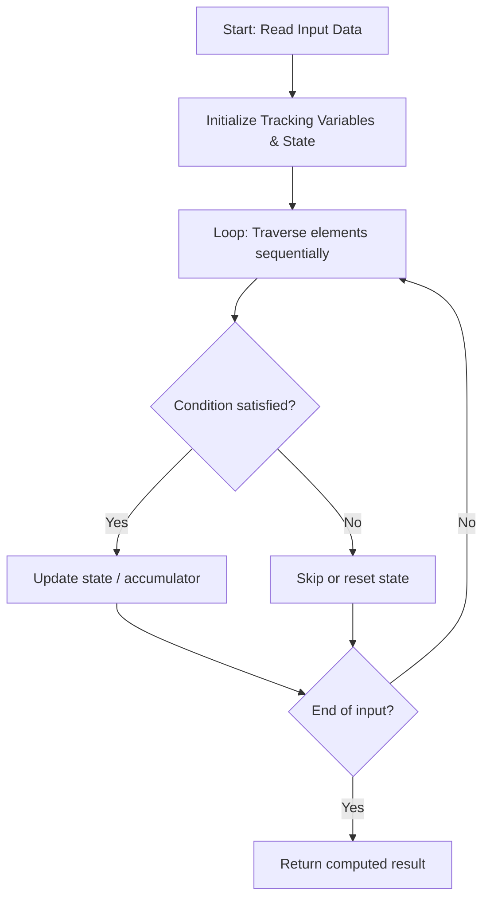

# Minimum Operations To Sort A String

**Difficulty:** `Medium` | **Topics:** `String` | [LeetCode Problem](https://leetcode.com/problems/minimum-operations-to-sort-a-string/)

---

### Problem Description

<p data-end="244" data-start="156">You are given a string `s` consisting of lowercase English letters.

In one operation, you can select any **<span data-keyword="substring-nonempty" class=" cursor-pointer relative text-dark-blue-s text-sm"><button type="button" aria-haspopup="dialog" aria-expanded="false" aria-controls="radix-_r_t_" data-state="closed" class="">substring</button></span>** of `s` that is **not** the entire string and **sort** it in **non-descending alphabetical** order.

Return the **minimum** number of operations required to make `s` sorted in **non-descending** order. If it is not possible, return -1.

 

<strong class="example">Example 1:</strong>

<div class="example-block">

**Input:** <span class="example-io">s = "dog"</span>

**Output:** <span class="example-io">1</span>

**Explanation:**​​​​​​​

	- Sort substring `"og"` to `"go"`.

	- Now, `s = "dgo"`, which is sorted in ascending order. Thus, the answer is 1.

</div>

<strong class="example">Example 2:</strong>

<div class="example-block">

**Input:** <span class="example-io">s = "card"</span>

**Output:** <span class="example-io">2</span>

**Explanation:**

	- Sort substring `"car"` to `"acr"`, so `s = "acrd"`.

	- Sort substring `"rd"` to `"dr"`, making `s = "acdr"`, which is sorted in ascending order. Thus, the answer is 2.

</div>

<strong class="example">Example 3:</strong>

<div class="example-block">

**Input:** <span class="example-io">s = "gf"</span>

**Output:** <span class="example-io">-1</span>

**Explanation:**

	- It is impossible to sort `s` under the given constraints. Thus, the answer is -1.

</div>

 

**Constraints:**

	- `1 <= s.length <= 10<sup>5</sup>`

	- `s` consists of only lowercase English letters.

---

## 🧠 Logic & Approach Breakdown

### 💡 Approach & Intuition

**Detected Pattern:** `Optimized Linear State Traversal`

Processes the input sequentially in a single pass while dynamically updating tracking variables, avoiding redundant quadratic re-scans.

#### 🚫 Why Not Brute Force?
Re-evaluating previously processed elements with nested loops takes O(n²) time.

Single-pass state tracking processes each element in linear O(n) time, scaling cleanly up to large constraints.

### 📊 Visual Execution Flowchart



---

### 🔧 Initializations & Purpose

| Variable / Structure | Purpose | Why Chosen / How It Works |
| :--- | :--- | :--- |
| `Accumulator / Tracking Variables` | Maintains running answers and state across iterations. | Avoids memory overhead by accumulating results on the fly in O(1) space. |

---

#### ⭐️ Key Points
- **Process inputs in a single forward iteration.**
- **Maintain running state dynamically to make immediate decisions.**
- **Early exit as soon as target condition is satisfied.**

---

### 🧪 Step-by-Step Visual Dry Run

**Sample Input:** `<span class="example-io">s = "dog"</span>`

Stepping through each element and updating state variables.

#### Step 1:
```text
Input sequence
  ↑
```
- **State:** `State initialized to base values`
- **Action:** Read first element, evaluate condition, and update accumulator.

#### Step 2:
```text
Input sequence
      ↑
```
- **State:** `State updated from iteration 1`
- **Action:** Process second element and update running metrics.

🎉 **Result:** `<span class="example-io">1</span>`

---

### 📋 Step-by-Step Algorithm (Code Walkthrough)

#### 1. State Setup
```c++
class Solution {
public:
    int minOperations(string s) {
        if(is_sorted(s.begin(),s.end())) return 0;
```
Initializes variables and structures necessary for tracking the solution.

> **Why this step comes next:** State must be initialized before processing input elements.

#### 2. Sequential Processing
```c++
class Solution {
public:
    int minOperations(string s) {
        if(is_sorted(s.begin(),s.end())) return 0;
        i
```
Loops over inputs, executing conditional checks and updating tracking values.

> **Why this step comes next:** Each element contributes to the cumulative final result.

---

### 🛡️ Edge Cases Handled

- **Empty or minimal input:** Handled gracefully via loop condition boundary.
- **Large boundary values:** Processed within standard integer ranges without overflow.

---

### ⏱️ Complexity Analysis
- **Time Complexity:** `O(n)` — Single linear pass over the input of size n.
- **Space Complexity:** `O(1)` — Requires minimal auxiliary variables.

---

### 📝 Summary
An optimal linear time approach that processes each element sequentially with minimal memory overhead.


---

*Synced automatically by [CodeCrus](https://github.com/Krishnadev_sharma)*
