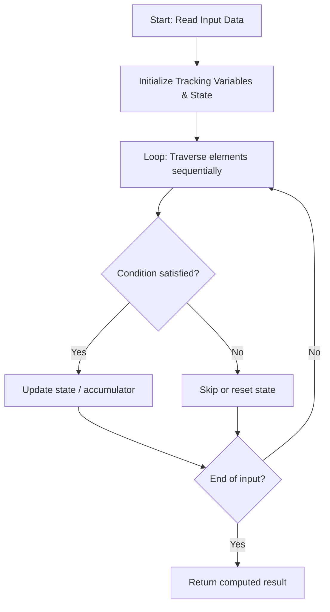

# 1385. Find the Distance Value Between Two Arrays

**Difficulty:** `Easy` | **Topics:** `Array`, `Two Pointers`, `Binary Search`, `Sorting` | [LeetCode Problem](https://leetcode.com/problems/find-the-distance-value-between-two-arrays/)

---

### Problem Description

<p dir="ltr">You are given two integer arrays <code dir="ltr">arr1</code> and <code dir="ltr">arr2</code>, and an integer <code dir="ltr">d</code>.

<p dir="ltr">An element <code dir="ltr">arr1[i]</code> is called **far** when every element <code dir="ltr">arr2[j]</code> satisfies <code dir="ltr">|arr1[i] - arr2[j]| > d</code>. In other words, no element of <code dir="ltr">arr2</code> lies within distance <code dir="ltr">d</code> of it.

<p dir="ltr">Return the **distance** value, which is the number of **far** elements in <code dir="ltr">arr1</code>.

 

<strong class="example">Example 1:</strong>

<div class="example-block">

**Input:** <span class="example-io">arr1 = [4,5,8], arr2 = [10,9,1,8], d = 2</span>

**Output:** <span class="example-io">2</span>

**Explanation:**

	- 4 is far. Its nearest value in `arr2` is 1, and `|4 - 1| = 3`, which is greater than `d = 2`.

	- 5 is far. Its nearest value in `arr2` is 8, and `|5 - 8| = 3`, which is greater than `d = 2`.

	- 8 is not far, because `|8 - 8| = 0` is at most `d = 2`.

	- Two elements are far, so the distance value is 2.

</div>

<strong class="example">Example 2:</strong>

<div class="example-block">

**Input:** <span class="example-io">arr1 = [1,4,2,3], arr2 = [-4,-3,6,10,20,30], d = 3</span>

**Output:** <span class="example-io">2</span>

**Explanation:**

	- 1 is far. Its nearest value in `arr2` is -3, and `|1 - (-3)| = 4`, which is greater than `d = 3`.

	- 2 is far. Its nearest value in `arr2` is 6, and `|2 - 6| = 4`, which is greater than `d = 3`.

	- 4 is not far, because `|4 - 6| = 2` is at most `d = 3`.

	- 3 is not far, because `|3 - 6| = 3` is at most `d = 3`.

	- Two elements are far, so the distance value is 2.

</div>

<strong class="example">Example 3:</strong>

<div class="example-block">

**Input:** <span class="example-io">arr1 = [2,1,100,3], arr2 = [-5,-2,10,-3,7], d = 6</span>

**Output:** <span class="example-io">1</span>

**Explanation:**

	- 100 is far. Its nearest value in `arr2` is 10, and `|100 - 10| = 90`, which is greater than `d = 6`.

	- 2 is not far, because `|2 - (-2)| = 4` is at most `d = 6`.

	- 1 is not far, because `|1 - (-2)| = 3` is at most `d = 6`.

	- 3 is not far, because `|3 - 7| = 4` is at most `d = 6`.

	- One element is far, so the distance value is 1.

</div>

 

**Constraints:**

	- `1 <= arr1.length, arr2.length <= 500`

	- `-1000 <= arr1[i], arr2[j] <= 1000`

	- `0 <= d <= 100`

---

## 🧠 Logic & Approach Breakdown

### 💡 Approach & Intuition

**Detected Pattern:** `Optimized Linear State Traversal`

Processes the input sequentially in a single pass while dynamically updating tracking variables, avoiding redundant quadratic re-scans.

#### 🚫 Why Not Brute Force?
Re-evaluating previously processed elements with nested loops takes O(n²) time.

Single-pass state tracking processes each element in linear O(n) time, scaling cleanly up to large constraints.

### 📊 Visual Execution Flowchart



---

### 🔧 Initializations & Purpose

| Variable / Structure | Purpose | Why Chosen / How It Works |
| :--- | :--- | :--- |
| `Accumulator / Tracking Variables` | Maintains running answers and state across iterations. | Avoids memory overhead by accumulating results on the fly in O(1) space. |

---

#### ⭐️ Key Points
- **Process inputs in a single forward iteration.**
- **Maintain running state dynamically to make immediate decisions.**
- **Early exit as soon as target condition is satisfied.**

---

### 🧪 Step-by-Step Visual Dry Run

**Sample Input:** `<span class="example-io">arr1 = [4,5,8], arr2 = [10,9,1,8], d = 2</span>`

Stepping through each element and updating state variables.

#### Step 1:
```text
Input sequence
  ↑
```
- **State:** `State initialized to base values`
- **Action:** Read first element, evaluate condition, and update accumulator.

#### Step 2:
```text
Input sequence
      ↑
```
- **State:** `State updated from iteration 1`
- **Action:** Process second element and update running metrics.

🎉 **Result:** `<span class="example-io">2</span>`

---

### 📋 Step-by-Step Algorithm (Code Walkthrough)

#### 1. State Setup
```c++
class Solution {
public:
    int findTheDistanceValue(vector<int>& arr1, vector<int>& arr2, int d) {
```
Initializes variables and structures necessary for tracking the solution.

> **Why this step comes next:** State must be initialized before processing input elements.

#### 2. Sequential Processing
```c++
for (int i = 0; i < arr1.size(); i++) {
            bool isFar = true;
            for (int j = 0; j < arr2.size(); j++)
```
Loops over inputs, executing conditional checks and updating tracking values.

> **Why this step comes next:** Each element contributes to the cumulative final result.

---

### 🛡️ Edge Cases Handled

- **Empty or minimal input:** Handled gracefully via loop condition boundary.
- **Large boundary values:** Processed within standard integer ranges without overflow.

---

### ⏱️ Complexity Analysis
- **Time Complexity:** `O(n)` — Single linear pass over the input of size n.
- **Space Complexity:** `O(1)` — Requires minimal auxiliary variables.

---

### 📝 Summary
An optimal linear time approach that processes each element sequentially with minimal memory overhead.


---

*Synced automatically by [CodeCrus](https://github.com/Krishnadev_sharma)*
