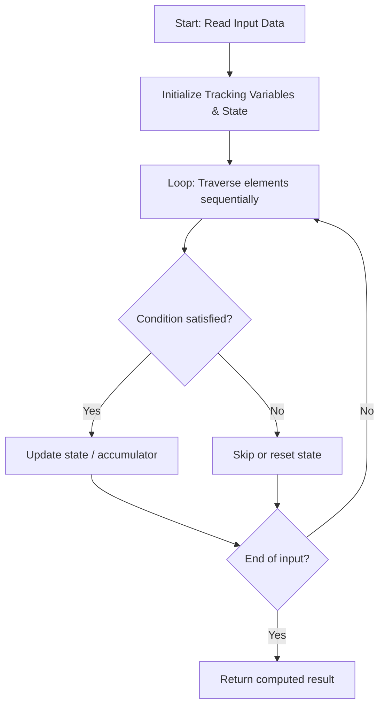

# 3644. Maximum K to Sort a Permutation

**Difficulty:** `Medium` | **Topics:** `Array`, `Bit Manipulation` | [LeetCode Problem](https://leetcode.com/problems/maximum-k-to-sort-a-permutation/)

---

### Problem Description

You are given an integer array `nums` of length `n`, where `nums` is a **<span data-keyword="permutation-array">permutation</span>** of the numbers in the range `[0..n - 1]`.

You may swap elements at indices `i` and `j` **only if** `nums[i] AND nums[j] == k`, where `AND` denotes the bitwise AND operation and `k` is a **non-negative** integer.

Return the **maximum** value of `k` such that the array can be sorted in **non-decreasing** order using any number of such swaps. If `nums` is already sorted, return 0.

 

<strong class="example">Example 1:</strong>

<div class="example-block">

**Input:** <span class="example-io">nums = [0,3,2,1]</span>

**Output:** <span class="example-io">1</span>

**Explanation:**

Choose `k = 1`. Swapping `nums[1] = 3` and `nums[3] = 1` is allowed since `nums[1] AND nums[3] == 1`, resulting in a sorted permutation: `[0, 1, 2, 3]`.
</div>

<strong class="example">Example 2:</strong>

<div class="example-block">

**Input:** <span class="example-io">nums = [0,1,3,2]</span>

**Output:** <span class="example-io">2</span>

**Explanation:**

Choose `k = 2`. Swapping `nums[2] = 3` and `nums[3] = 2` is allowed since `nums[2] AND nums[3] == 2`, resulting in a sorted permutation: `[0, 1, 2, 3]`.
</div>

<strong class="example">Example 3:</strong>

<div class="example-block">

**Input:** <span class="example-io">nums = [3,2,1,0]</span>

**Output:** <span class="example-io">0</span>

**Explanation:**

Only `k = 0` allows sorting since no greater `k` allows the required swaps where `nums[i] AND nums[j] == k`.
</div>

 

**Constraints:**

	- `1 <= n == nums.length <= 10<sup>5</sup>`

	- `0 <= nums[i] <= n - 1`

	- `nums` is a permutation of integers from `0` to `n - 1`.

---

## 🧠 Logic & Approach Breakdown

### 💡 Approach & Intuition

**Detected Pattern:** `Optimized Linear State Traversal`

Processes the input sequentially in a single pass while dynamically updating tracking variables, avoiding redundant quadratic re-scans.

#### 🚫 Why Not Brute Force?
Re-evaluating previously processed elements with nested loops takes O(n²) time.

Single-pass state tracking processes each element in linear O(n) time, scaling cleanly up to large constraints.

### 📊 Visual Execution Flowchart



---

### 🔧 Initializations & Purpose

| Variable / Structure | Purpose | Why Chosen / How It Works |
| :--- | :--- | :--- |
| `Accumulator / Tracking Variables` | Maintains running answers and state across iterations. | Avoids memory overhead by accumulating results on the fly in O(1) space. |

---

#### ⭐️ Key Points
- **Process inputs in a single forward iteration.**
- **Maintain running state dynamically to make immediate decisions.**
- **Early exit as soon as target condition is satisfied.**

---

### 🧪 Step-by-Step Visual Dry Run

**Sample Input:** `<span class="example-io">nums = [0,3,2,1]</span>`

Stepping through each element and updating state variables.

#### Step 1:
```text
Input sequence
  ↑
```
- **State:** `State initialized to base values`
- **Action:** Read first element, evaluate condition, and update accumulator.

#### Step 2:
```text
Input sequence
      ↑
```
- **State:** `State updated from iteration 1`
- **Action:** Process second element and update running metrics.

🎉 **Result:** `<span class="example-io">1</span>`

---

### 📋 Step-by-Step Algorithm (Code Walkthrough)

#### 1. State Setup
```c++
class Solution {
public:
    int sortPermutation(vector<int>& nums) {
```
Initializes variables and structures necessary for tracking the solution.

> **Why this step comes next:** State must be initialized before processing input elements.

#### 2. Sequential Processing
```c++
for (int i = 0; i < n; i++) {
            if (nums[i] != i) {
                if (k == -1) {
                    k = num
```
Loops over inputs, executing conditional checks and updating tracking values.

> **Why this step comes next:** Each element contributes to the cumulative final result.

---

### 🛡️ Edge Cases Handled

- **Empty or minimal input:** Handled gracefully via loop condition boundary.
- **Large boundary values:** Processed within standard integer ranges without overflow.

---

### ⏱️ Complexity Analysis
- **Time Complexity:** `O(n)` — Single linear pass over the input of size n.
- **Space Complexity:** `O(1)` — Requires minimal auxiliary variables.

---

### 📝 Summary
An optimal linear time approach that processes each element sequentially with minimal memory overhead.


---

*Synced automatically by [CodeCrus](https://github.com/Krishnadev_sharma)*
