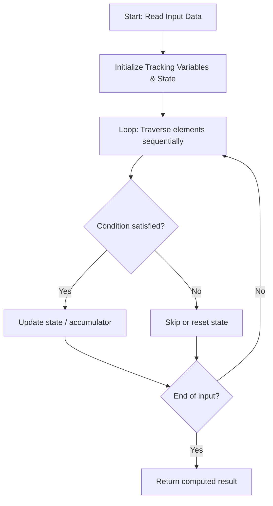

# 3736. Minimum Moves to Equal Array Elements III

**Difficulty:** `Easy` | **Topics:** `Array`, `Math` | [LeetCode Problem](https://leetcode.com/problems/minimum-moves-to-equal-array-elements-iii/)

---

### Problem Description

You are given an integer array `nums`.

In one move, you may **increase** the value of any single element `nums[i]` by 1.

Return the **minimum total** number of **moves** required so that all elements in `nums` become **equal**.

 

<strong class="example">Example 1:</strong>

<div class="example-block">

**Input:** <span class="example-io">nums = [2,1,3]</span>

**Output:** <span class="example-io">3</span>

**Explanation:**

To make all elements equal:

	- Increase `nums[0] = 2` by 1 to make it 3.

	- Increase `nums[1] = 1` by 1 to make it 2.

	- Increase `nums[1] = 2` by 1 to make it 3.

Now, all elements of `nums` are equal to 3. The minimum total moves is `3`.
</div>

<strong class="example">Example 2:</strong>

<div class="example-block">

**Input:** <span class="example-io">nums = [4,4,5]</span>

**Output:** <span class="example-io">2</span>

**Explanation:**

To make all elements equal:

	- Increase `nums[0] = 4` by 1 to make it 5.

	- Increase `nums[1] = 4` by 1 to make it 5.

Now, all elements of `nums` are equal to 5. The minimum total moves is `2`.
</div>

 

**Constraints:**

	- `1 <= nums.length <= 100`

	- `1 <= nums[i] <= 100`

---

## 🧠 Logic & Approach Breakdown

### 💡 Approach & Intuition

**Detected Pattern:** `Optimized Linear State Traversal`

Processes the input sequentially in a single pass while dynamically updating tracking variables, avoiding redundant quadratic re-scans.

#### 🚫 Why Not Brute Force?
Re-evaluating previously processed elements with nested loops takes O(n²) time.

Single-pass state tracking processes each element in linear O(n) time, scaling cleanly up to large constraints.

### 📊 Visual Execution Flowchart



---

### 🔧 Initializations & Purpose

| Variable / Structure | Purpose | Why Chosen / How It Works |
| :--- | :--- | :--- |
| `Accumulator / Tracking Variables` | Maintains running answers and state across iterations. | Avoids memory overhead by accumulating results on the fly in O(1) space. |

---

#### ⭐️ Key Points
- **Process inputs in a single forward iteration.**
- **Maintain running state dynamically to make immediate decisions.**
- **Early exit as soon as target condition is satisfied.**

---

### 🧪 Step-by-Step Visual Dry Run

**Sample Input:** `<span class="example-io">nums = [2,1,3]</span>`

Stepping through each element and updating state variables.

#### Step 1:
```text
Input sequence
  ↑
```
- **State:** `State initialized to base values`
- **Action:** Read first element, evaluate condition, and update accumulator.

#### Step 2:
```text
Input sequence
      ↑
```
- **State:** `State updated from iteration 1`
- **Action:** Process second element and update running metrics.

🎉 **Result:** `<span class="example-io">3</span>`

---

### 📋 Step-by-Step Algorithm (Code Walkthrough)

#### 1. State Setup
```c++
class Solution {
public:
    int minMoves(vector<int>& nums) {
```
Initializes variables and structures necessary for tracking the solution.

> **Why this step comes next:** State must be initialized before processing input elements.

#### 2. Sequential Processing
```c++
for(int i = 0; i < n; i++){
            if(nums[i] > mx)
            mx = nums[i];
        }
        for(int i = 0; i <
```
Loops over inputs, executing conditional checks and updating tracking values.

> **Why this step comes next:** Each element contributes to the cumulative final result.

---

### 🛡️ Edge Cases Handled

- **Empty or minimal input:** Handled gracefully via loop condition boundary.
- **Large boundary values:** Processed within standard integer ranges without overflow.

---

### ⏱️ Complexity Analysis
- **Time Complexity:** `O(n)` — Single linear pass over the input of size n.
- **Space Complexity:** `O(1)` — Requires minimal auxiliary variables.

---

### 📝 Summary
An optimal linear time approach that processes each element sequentially with minimal memory overhead.


---

*Synced automatically by [CodeCrus](https://github.com/Krishnadev_sharma)*
