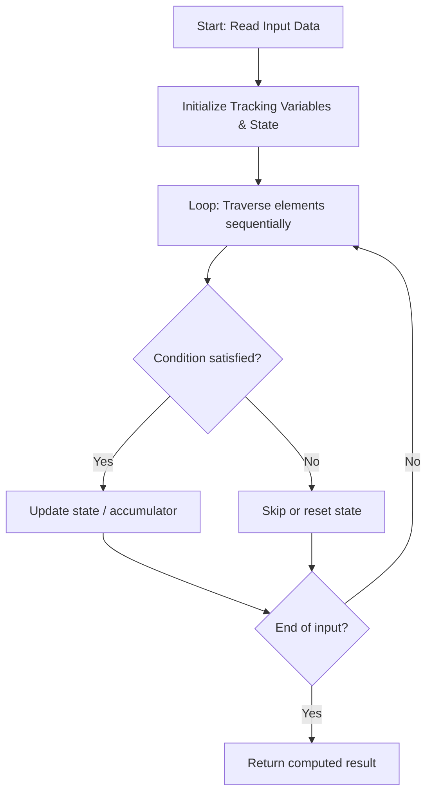

# 3963. Create Grid With Exactly One Path

**Difficulty:** `Easy` | [LeetCode Problem](https://leetcode.com/problems/create-grid-with-exactly-one-path/)

---

### Problem Description

You are given two integers `m` and `n`, representing the number of rows and columns of a grid.

Construct **any** `m x n` grid consisting only of the characters `'.'` and `'#'`, where:

	- `'.'` represents a free cell.

	- `'#'` represents an obstacle cell.

A **valid path** is a sequence of free cells that:

	- Starts at the top-left cell `(0, 0)`.

	- Ends at the bottom-right cell `(m - 1, n - 1)`.

	- Moves only:
	

		- Right, from `(i, j)` to `(i, j + 1)`, or

		- Down, from `(i, j)` to `(i + 1, j)`.

	

	

Return any grid such that there is **exactly one valid path** from the top-left cell to the bottom-right cell.

 

<strong class="example">Example 1:</strong>

<div class="example-block">

**Input:** <span class="example-io">m = 2, n = 3</span>

**Output:** <span class="example-io">["..#","#.."]</span>

**Explanation:**


The only valid path is: `(0,0) &rarr; (0,1) &rarr; (1,1) &rarr; (1,2)`
</div>

<strong class="example">Example 2:</strong>

<div class="example-block">

**Input:** <span class="example-io">m = 3, n = 3</span>

**Output:** <span class="example-io">["..#","#..","##."]</span>

**Explanation:**


The only valid path is: `(0,0) &rarr; (0,1) &rarr; (1,1) &rarr; (1,2) &rarr; (2,2)`
</div>

<strong class="example">Example 3:</strong>

<div class="example-block">

**Input:** <span class="example-io">m = 1, n = 4</span>

**Output:** <span class="example-io">["...."]</span>

**Explanation:**

The only valid path is: `(0,0) &rarr; (0,1) &rarr; (0,2) &rarr; (0,3)`
</div>

 

**Constraints:**

	- `1 <= m, n <= 25`

---

## 🧠 Logic & Approach Breakdown

### 💡 Approach & Intuition

**Detected Pattern:** `Optimized Linear State Traversal`

Processes the input sequentially in a single pass while dynamically updating tracking variables, avoiding redundant quadratic re-scans.

#### 🚫 Why Not Brute Force?
Re-evaluating previously processed elements with nested loops takes O(n²) time.

Single-pass state tracking processes each element in linear O(n) time, scaling cleanly up to large constraints.

### 📊 Visual Execution Flowchart



---

### 🔧 Initializations & Purpose

| Variable / Structure | Purpose | Why Chosen / How It Works |
| :--- | :--- | :--- |
| `Accumulator / Tracking Variables` | Maintains running answers and state across iterations. | Avoids memory overhead by accumulating results on the fly in O(1) space. |

---

#### ⭐️ Key Points
- **Process inputs in a single forward iteration.**
- **Maintain running state dynamically to make immediate decisions.**
- **Early exit as soon as target condition is satisfied.**

---

### 🧪 Step-by-Step Visual Dry Run

**Sample Input:** `<span class="example-io">m = 2, n = 3</span>`

Stepping through each element and updating state variables.

#### Step 1:
```text
Input sequence
  ↑
```
- **State:** `State initialized to base values`
- **Action:** Read first element, evaluate condition, and update accumulator.

#### Step 2:
```text
Input sequence
      ↑
```
- **State:** `State updated from iteration 1`
- **Action:** Process second element and update running metrics.

🎉 **Result:** `<span class="example-io">["..#","#.."]</span>`

---

### 📋 Step-by-Step Algorithm (Code Walkthrough)

#### 1. State Setup
```c++
class Solution {
public:
    vector<string> createGrid(int m, int n) {
```
Initializes variables and structures necessary for tracking the solution.

> **Why this step comes next:** State must be initialized before processing input elements.

#### 2. Sequential Processing
```c++
for(int j = 0; j < n; j++){
            grid[0][j] = '.';
        }
        for(int i = 0; i < m; i++){
            grid
```
Loops over inputs, executing conditional checks and updating tracking values.

> **Why this step comes next:** Each element contributes to the cumulative final result.

---

### 🛡️ Edge Cases Handled

- **Empty or minimal input:** Handled gracefully via loop condition boundary.
- **Large boundary values:** Processed within standard integer ranges without overflow.

---

### ⏱️ Complexity Analysis
- **Time Complexity:** `O(n)` — Single linear pass over the input of size n.
- **Space Complexity:** `O(1)` — Requires minimal auxiliary variables.

---

### 📝 Summary
An optimal linear time approach that processes each element sequentially with minimal memory overhead.


---

*Synced automatically by [CodeCrus](https://github.com/Krishnadev_sharma)*
